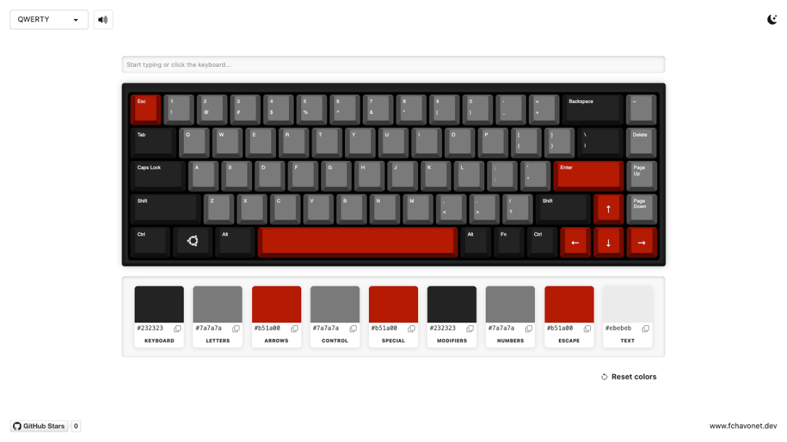

# Custom Keyboard Color Configurator

## Description

Custom Keyboard Color Configurator is an interactive web application that lets users experiment with different color combinations on a virtual mechanical keyboard.

I originally created this project at the very beginning of my web development training. At the time, I was building my own custom mechanical keyboard and wanted a simple way to visualize different keycap colors before ordering a set.

I couldn't find a tool that suited my needs, so I decided to build one myself using HTML, CSS, and JavaScript.

Since then, much more advanced tools have appeared, such as [Keyboard Simulator](https://keyboardsimulator.xyz/). However, I never published my original project on GitHub because I considered the code too rough and unfinished.

Years later, I decided to revisit it, clean up its structure, and introduce a few improvements while preserving as much of the original design and behavior as possible.

The result is a small personal project that reflects both my early experiments with web development and the progress I've made since then.

As a personal touch, the mechanical keypress sound comes from an actual recording of my own keyboard 🥰 !

## Objectives

- Preserve the original keyboard design and its mechanical keycap appearance.
- Create an interactive virtual keyboard that reacts to physical keyboard inputs and mouse clicks.
- Support AZERTY and QWERTY layouts using external JSON files (new feature).
- Allow users to customize individual keycap color groups and text colors.
- Provide hexadecimal color inputs and copy-to-clipboard functionality.
- Implement a reset button to restore the original color palette (new feature).
- Add mechanical keyboard sound effects using the Web Audio API.
- Save user preferences locally using localStorage (new feature).
- Improve responsiveness for desktop and tablet screens.
- Modernize the original code while keeping the project lightweight and framework-free.

## Tech Stack


## File Description

| **FILE**     | **DESCRIPTION**                                                                               |
| :----------: | --------------------------------------------------------------------------------------------- |
| `assets`     | Contains the resources required for the repository.                                           |
| `layouts`    | Contains the AZERTY and QWERTY keyboard definitions in JSON format.                           |
| `index.html` | Main HTML structure, keyboard template, and interface components.                             |
| `style.css`  | Keyboard appearance, keycap effects, color selectors, and responsive styles.                  |
| `script.js`  | Keyboard generation, interactions, color customization, audio playback, and user preferences. |
| `README.md`  | The README file you are currently reading 😉.                                                 |

## Installation & Usage

### Installation

1. Clone this repository:
    - Open your preferred Terminal.
    - Navigate to the directory where you want to clone the repository.
    - Run the following command:

```
git clone https://github.com/fchavonet/creative_coding-custom_keyboard_color_configurator.git
```

2. Open the cloned repository.

3. Start a local web server from the project directory:

```
python3 -m http.server 8000
```

4. Open [http://localhost:8000](http://localhost:8000) in your web browser.

> The project must be served through HTTP because keyboard layouts are loaded from JSON files using the Fetch API. Opening `index.html` directly from the file system may prevent the keyboard from loading.

### Usage

1. Select the AZERTY or QWERTY keyboard layout using the dropdown menu.

2. Press keys on your physical keyboard or click the virtual keycaps to interact with the keyboard.

3. Use the color pickers to customize the keyboard case, keycap groups, and text colors.

4. Enter hexadecimal color values manually or use the copy buttons to copy them to your clipboard.

5. Click Reset colors to restore the original color palette.

6. Use the sound button to enable or disable the mechanical keyboard sound.

You can also test the project online by clicking [here](https://fchavonet.github.io/creative_coding-custom_keyboard_color_configurator/).

<p align="center">
    <picture>
        <source media="(prefers-color-scheme: light)" srcset="./assets/screenshots/desktop_page_screenshot-light.webp">
        <source media="(prefers-color-scheme: dark)" srcset="./assets/screenshots/desktop_page_screenshot-dark.webp">
        
    </picture>
</p>

## What's Next?

- Explore the possibility of exporting customized keyboard color schemes.
- Improve the experience on smaller screens and touch devices.
- Consider adding additional keyboard layouts.

## Thanks

- Thanks to the developers and mechanical keyboard enthusiasts who share their creations and inspire others to experiment with custom keyboards.

## Author(s)

**Fabien CHAVONET**
- [GitHub](https://github.com/fchavonet)
- [itch.io](https://fchavonet.itch.io/)
- [LinkedIn](https://www.linkedin.com/in/fchavonet/)
- [Portfolio](https://www.fchavonet.dev)
